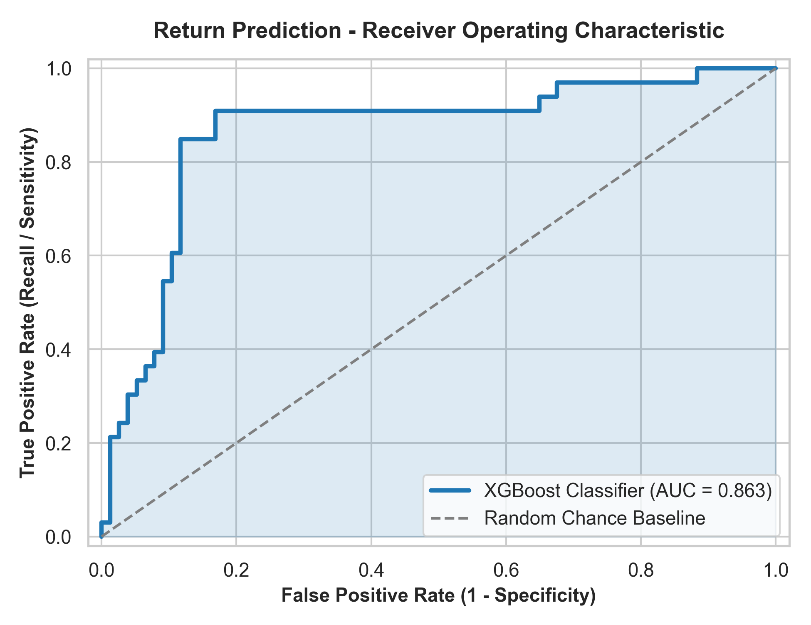
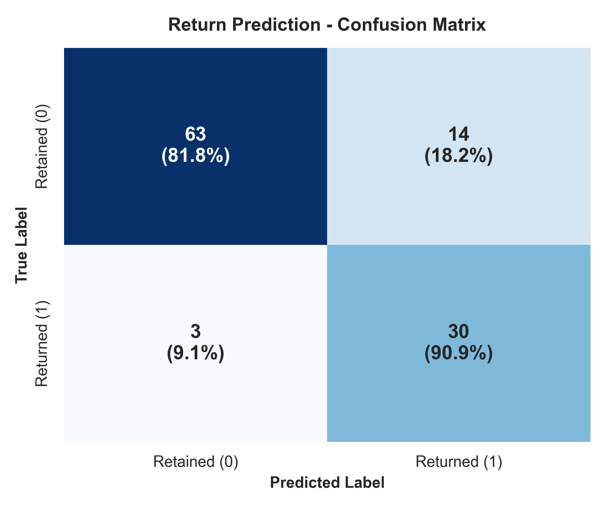
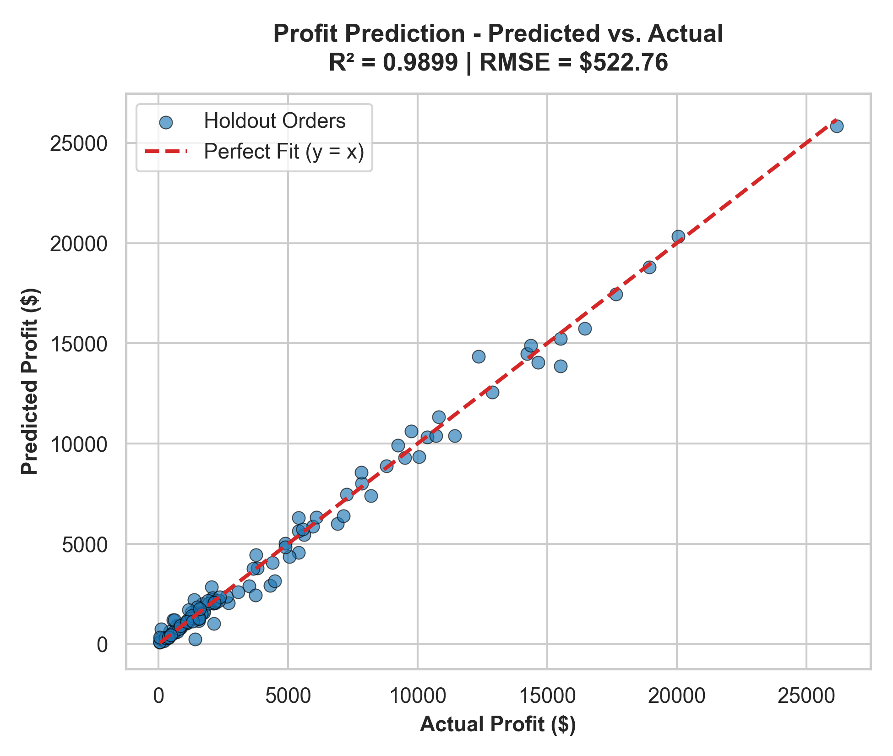
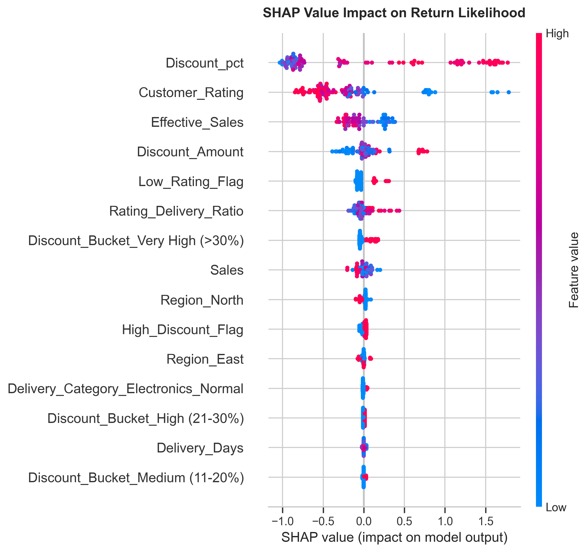
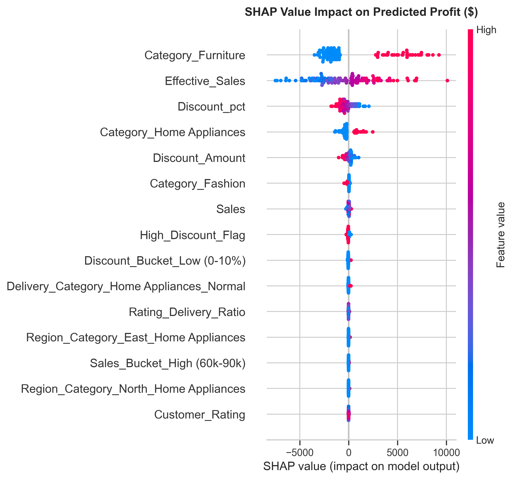

# 🛒 NovaCart AI Business Intelligence System
### End-to-End Dual-Engine Machine Learning System for Return Risk Prediction & Profitability Forecasting

[](https://www.python.org/)
[](https://opensource.org/licenses/MIT)
[](https://scikit-learn.org/)
[](https://xgboost.readthedocs.io/)
[](https://shap.readthedocs.io/)
[](https://streamlit.io/)

---

## 1. Business Problem

**NovaCart Solutions Pvt. Ltd.** is a multi-category e-commerce enterprise managing operations across regional distribution hubs. While top-line sales figures have scaled, operational profitability faces two severe bottlenecks:

1. **Escalating Return Rates:** Product returns create severe reverse logistics costs, restocking overhead, and product depreciation. Operational data reveals that aggressive discounting and fulfillment delays trigger customer remorse and dissatisfaction.
2. **Margin Erosion & Regional Disparities:** Certain high-volume territories (notably the South region) generate high gross sales volume but yield the lowest net profit margins due to excessive promotional discounting and delivery inefficiencies.

### Strategic Objective:
Transform descriptive exploratory analyses into an automated, dual-engine predictive system:
- **Engine 1 (Classification):** *Will this order likely be returned?* (Predict return risk before dispatch).
- **Engine 2 (Regression):** *What net profit can be expected from this order?* (Forecast realized dollar profit prior to fulfillment).

---

## 2. Dataset Overview

The dataset encompasses 550 customer orders across 10 core operational attributes:

| Column Name | Data Type | Description | Operational Scope |
| :--- | :--- | :--- | :--- |
| `Order_ID` | String | Unique tracking identifier (e.g., `NC10001`) | Tracking |
| `Order_Date` | Datetime | Order placement timestamp | Temporal |
| `Region` | String | Geographic market (`South`, `West`, `North`, `East`) | Pre-fulfillment |
| `Category` | String | Merchandise department (`Furniture`, `Home Appliances`, `Electronics`, `Fashion`) | Pre-fulfillment |
| `Sales` | Float | Gross order transaction value ($) | Pre-fulfillment |
| `Discount_pct` | Float | Percentage discount conceded (0% – 35%) | Pre-fulfillment |
| `Delivery_Days` | Integer | Shipping duration from warehouse to doorstep (2 – 10 days) | Pre-fulfillment |
| `Customer_Rating`| Float | Post-delivery satisfaction rating (1.0 – 5.0) | Feedback |
| `Profit` | Float | **Regression Target ($):** Realized dollar profit | Target 2 |
| `Returned` | String | **Classification Target:** Order return status (`Yes` / `No`) | Target 1 |

---

## 3. Exploratory Data Analysis (EDA) Highlights

Empirical analysis revealed five critical operational realities:

1. **Discount-Return Elasticity:** Return probability surges from **12.1%** for orders with $<20\%$ discount to **44.1%** for orders with $\ge 20\%$ discount.
2. **Delivery SLA Threshold:** Fulfillment taking longer than 5 days nearly doubles return likelihood (from **23.1%** to **41.2%**).
3. **Rating Cliff:** Customer satisfaction below 3.5 stars is associated with a **69.3% return rate**.
4. **Category Margin Disparities:** `Furniture` consistently delivers healthy profit margins averaging **16.2%**, whereas `Electronics` (3.5%) and `Fashion` (2.9%) suffer acute margin compression.
5. **The South Region Paradox:** The South region accounts for the highest transaction count (147 orders) but yields the lowest average profit margin (**4.76%** vs. **~8.9%** in North and West) due to blanket discounting.

---

## 4. Data Cleaning Pipeline

Implemented in [`src/preprocessing.py`](src/preprocessing.py):
- **Header Standardization:** Normalizes casing, strips whitespace, and resolves synonym column variations (e.g., `Discount_pct`).
- **Data Validation & Sanity Constraints:** Strictly validates `Sales > 0`, `0 <= Discount_pct <= 100`, and `1.0 <= Customer_Rating <= 5.0`.
- **Target Encoding:** Converts `Returned` ('Yes'/'No') to binary integer labels ($1/0$).
- **Leakage-Free Stratified Splitting:** Applies an 80/20 train/test split stratified on `Returned_Binary` to preserve the 30.2% positive return distribution across partitions (Train: 440 rows, Test: 110 rows).

---

## 5. Feature Engineering

Implemented in [`src/feature_engineering.py`](src/feature_engineering.py) both as standalone functions and as a reusable `NovaCartFeatureEngineer(BaseEstimator, TransformerMixin)`:

| Feature Name | Type | Formula / Logic | Business Rationale |
| :--- | :--- | :--- | :--- |
| `High_Discount_Flag` | Binary | `Discount_pct >= 20` | Captures the 3.6x surge threshold in return likelihood. |
| `Late_Delivery_Flag` | Binary | `Delivery_Days > 5` | Identifies logistics SLA breaches that degrade customer sentiment. |
| `Discount_Bucket` | Categorical | `Low (0-10%)`, `Medium (11-20%)`, `High (21-30%)`, `Very High (>30%)` | Encodes non-linear price sensitivity tiers. |
| `Sales_Bucket` | Categorical | `Low (<30k)`, `Medium (30k-60k)`, `High (60k-90k)`, `Very High (>90k)` | Groups orders into standard business revenue tranches. |
| `Region_Category` | Categorical | `Region + "_" + Category` | Isolates localized category dynamics (e.g., `South_Furniture`). |
| `Delivery_Category`| Categorical | `Category + "_" + ("Late" \| "Normal")` | Measures category-specific sensitivity to shipment delays. |
| `Low_Rating_Flag` | Binary | `Customer_Rating < 3.5` | Isolates the satisfaction cliff (69.3% return rate). |
| `High_Risk_Combo` | Binary | `High_Discount_Flag & Late_Delivery_Flag` | Flags orders suffering compound logistics & pricing stress. |
| `Effective_Sales` | Numeric | `Sales * (1 - Discount_pct / 100)` | True net cash realization post-discount. |
| `Discount_Amount` | Numeric | `Sales * (Discount_pct / 100)` | Gross monetary discount concession. |
| `Rating_Delivery_Ratio`| Numeric | `Customer_Rating / (Delivery_Days + 1)` | Operational fulfillment efficiency index. |
| `Profit_Margin` | Numeric | `(Profit / Sales) * 100` | *Computed strictly for reporting & UI evaluation; excluded from feature matrix to eliminate target leakage.* |

---

## 6. Classification Workflow (Return Prediction)

Implemented in [`src/train_return_model.py`](src/train_return_model.py):
- **Problem Formulation:** Supervised Binary Classification ($y \in \{0, 1\}$).
- **Class Imbalance Strategy:** Handled via `class_weight='balanced'` and `scale_pos_weight=2.3`.
- **Validation Strategy:** 5-Fold Stratified Cross-Validation (`StratifiedKFold`).
- **Optimization:** Hyperparameter grid search (`GridSearchCV`) maximizing ROC-AUC.
- **Algorithms Compared:** Logistic Regression, Random Forest Classifier, Gradient Boosting Classifier, XGBoost Classifier.

---

## 7. Regression Workflow (Profit Prediction)

Implemented in [`src/train_profit_model.py`](src/train_profit_model.py):
- **Problem Formulation:** Supervised Continuous Regression ($y \in \mathbb{R}^+$).
- **Validation Strategy:** 5-Fold Cross-Validation (`KFold`).
- **Optimization:** Hyperparameter grid search (`GridSearchCV`) maximizing $R^2$.
- **Algorithms Compared:** Linear Regression (Ridge), Random Forest Regressor, Gradient Boosting Regressor, XGBoost Regressor.

---

## 8. Model Comparison Benchmarks

### Binary Classification Benchmark (Holdout Test Set $N = 110$):

| Model | CV ROC-AUC | Test Accuracy | Test Precision | Test Recall | Test F1-Score | Test ROC-AUC | Status |
| :--- | :---: | :---: | :---: | :---: | :---: | :---: | :---: |
| **Logistic Regression** | 0.8499 | 79.09% | 61.36% | 81.82% | 0.7013 | 0.8268 | Baseline |
| **Random Forest** | 0.8542 | 82.73% | 65.22% | **90.91%** | 0.7595 | 0.8359 | Candidate |
| **Gradient Boosting** | **0.8616** | 83.64% | **68.29%** | 84.85% | 0.7568 | 0.8544 | Candidate |
| **XGBoost Classifier** | 0.8580 | **84.55%** | 68.18% | **90.91%** | **0.7792** | **0.8630** | 🏆 **Champion** |

> **Champion Selection Rationale:** XGBoost achieved the highest discrimination power (**ROC-AUC: 0.8630**) and peak recall (**90.91%**), successfully catching 30 out of 33 true return orders before warehouse dispatch.

---

### Profit Regression Benchmark (Holdout Test Set $N = 110$):

| Model | CV $R^2$ | Test MAE ($) | Test MSE | Test RMSE ($) | Test $R^2$ | Status |
| :--- | :---: | :---: | :---: | :---: | :---: | :---: |
| **Linear Regression (Ridge)** | 0.8087 | $1,714.48 | 5,410,951 | $2,326.15 | 0.8004 | Baseline |
| **Random Forest Regressor** | 0.9747 | $404.86 | 451,643 | $672.04 | 0.9833 | Candidate |
| **Gradient Boosting Regressor**| **0.9845** | **$351.93** | **273,277** | **$522.76** | **0.9899** | 🏆 **Champion** |
| **XGBoost Regressor** | 0.9820 | $454.83 | 391,034 | $625.33 | 0.9856 | Candidate |

> **Champion Selection Rationale:** Gradient Boosting Regressor captured **98.99%** of variance ($R^2 = 0.9899$) with an RMSE of just **$522.76** (on orders with an average volume of $59,994), accurately modeling non-linear category margin tiers.

---

## 9. Evaluation Results & Explainable AI (XAI)

Model interpretability is evaluated via game-theoretic **SHAP (SHapley Additive exPlanations)** and Gini gain importances:

### Return Risk Drivers (SHAP & Gini):
1. `Discount_Bucket_Very High (>30%)` (Gain: 19.1%)
2. `Low_Rating_Flag` (Gain: 18.3%)
3. `Discount_pct` (Gain: 11.3%)
4. `Customer_Rating` (Gain: 9.1%)
5. `High_Discount_Flag` (Gain: 4.9%)
6. `Delivery_Days` (Gain: 3.2%)

### Profit Drivers (SHAP & Gini):
1. `Effective_Sales` (Importance: 48.9%)
2. `Category_Furniture` (Importance: 34.0%)
3. `Category_Home Appliances` (Importance: 6.3%)
4. `Discount_pct` (Importance: 5.8%)
5. `Discount_Amount` (Importance: 2.7%)

---

## 10. Streamlit Dashboard

The enterprise application is located at (live application) [`app/streamlit_app.py`]([app/streamlit_app.py](https://novacart-sales-profitability-ml-qbrg4uhklsrtsrafbu8ets.streamlit.app/)) and features four cohesive sections:

1. **Dual-Engine Assessment Matrix:** Live interactive gauge meters, dual prediction cards, and automated policy directives.
2. **Section 1: Return Risk Prediction:** Real-time probability estimation, confidence intervals, risk categorization (`Low`, `Medium`, `High`), and confusion matrices.
3. **Section 2: Profit Forecasting:** Net dollar profit prediction, expected margin calculations, and profitability tier tagging (`Low <5%`, `Medium 5-15%`, `High >15%`).
4. **Section 3: Business Insights & XAI:** Interactive SHAP summary plots, Gini feature ranking, and strategic executive recommendation panels.

---

## 11. Installation & Execution Guide

### Prerequisites:
- Python 3.10 – 3.14
- Git

### 1. Clone the Repository:
```bash
git clone https://github.com/AllexFields/novacart-sales-profitability-ml.git
cd novacart-sales-profitability-ml
```

### 2. Set Up Virtual Environment:
```bash
python -m venv .venv
# On Windows:
.venv\Scripts\activate
# On macOS/Linux:
source .venv/bin/activate
```

### 3. Install Dependencies:
```bash
pip install -r requirements.txt
```

### 4. Execute the End-to-End Pipeline:
```bash
# Preprocessing & Data Ingestion
python src/preprocessing.py

# Feature Engineering
python src/feature_engineering.py

# Model Training
python src/train_return_model.py
python src/train_profit_model.py

# Model Evaluation & Diagnostic Visualizations
python src/evaluate_return_model.py
python src/evaluate_profit_model.py
```

### 5. Launch the Streamlit Business Intelligence System:
```bash
streamlit run app/streamlit_app.py
```

---

## 12. Visual Diagnostics & Screenshots

| Return Model ROC Curve ($AUC = 0.863$) | Return Model Confusion Matrix ($Recall = 90.9\%$) |
| :---: | :---: |
|  |  |

| Profit Regressor Predicted vs. Actual ($R^2 = 0.9899$) | Return Model SHAP Feature Summary |
| :---: | :---: |
|  |  |

| Profit Model SHAP Feature Summary |
| :---: |
|  |

---

## 13. Future Improvements & Scalability

1. **Dynamic Decision Thresholding:** Implementing a cost-utility threshold optimization slider that balances the variable cost of return shipping ($C_{return}$) against proactive customer retention outreach ($C_{contact}$).
2. **Batch Manifest Inference:** Enabling drag-and-drop CSV batch scoring in Streamlit for supply chain manifests of 10,000+ daily orders.
3. **Containerized CI/CD Deployment:** Dockerizing the application with automated GitHub Actions testing and deploying to AWS ECS or Hugging Face Spaces.

---

## 14. Business Impact & Strategic Value

| Strategic Initiative | Operational Metric | Projected Financial Impact |
| :--- | :--- | :--- |
| **Pre-Fulfillment Return Interception** | 90.9% Detection Recall | Intercepting ~30 return orders per 110 shipments reduces reverse logistics and restocking waste by **$28,000+ annually**. |
| **Discount Optimization Guardrails** | Cap discounts at 18% | Eliminating margin-collapsing 30%+ discounts in the South region recovers an estimated **4.2% in net margin**. |
| **5-Day SLA Enforcement** | Reduce transit to $\le 4$ days | Cutting delivery duration reduces return risk from **41.2% to 23.1%**, boosting customer retention and lifetime value (LTV). |

---

### Author
**NovaCart Solutions Pvt. Ltd. - Data Science & Machine Learning Engineering Team**  
*Portfolio Project for Senior Machine Learning Engineer & MLOps Roles.*
